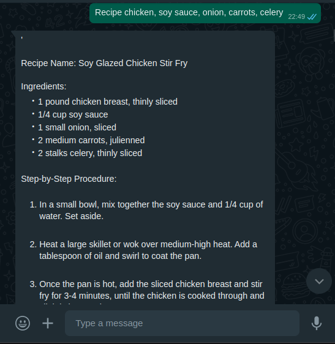
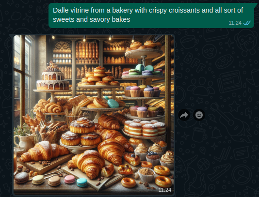
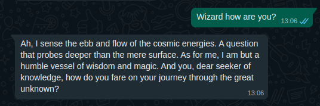

# WhatsApp assistant

This project was made as a learning experience to practice and showcase my knowledge.

## Features:

Backend server made in **Node.js**:

- Listens to a Whatsapp Account and responds with messages accordingly.
- Currently you can send and receive messages to OpenAI models directly from Whatsapp.
- Get Weather forecast, speak with an AI wizard, randomnly stored pictures in the server and much more.

## Claude agent

`claude…` WhatsApp messages are forwarded to [agent-runner](../agent-runner) (`AGENT_RUNNER_URL`), which runs the headless Claude agent, the GitHub issue pipeline and the cron issue tracer. Monitoring (`npm run agent:status`, `agent:watch`, `agent:history`, `agent:logs`) lives there too. Old `logs/claude-agent/` data from the in-process pipeline can be archived or deleted by hand.

## Contributing

See [CONTRIBUTING.md](CONTRIBUTING.md) for how to sync with `main`, branch, and open pull requests before starting new work.
